# Arquitetura do Backend — GreenER

Este documento descreve a organização e as responsabilidades do backend. O
contrato das APIs está em [docs/API.md](../docs/API.md), e as fórmulas e regras
dos cálculos ambientais estão em [docs/cálculo.md](../docs/cálculo.md).

## Estado da implementação

| Módulo        | Responsabilidade atual                                                                                                            |
| ------------- | --------------------------------------------------------------------------------------------------------------------------------- |
| `services`    | Lista e detalha serviços, consulta a última amostra e o histórico de tentativas.                                                  |
| `collections` | Sincroniza regiões e serviços, coleta métricas, grava amostras e observações e lista o resultado da última tentativa por serviço. |
| `analytics`   | Consulta as amostras de um serviço, agrupadas por período, com pontos e totais.                                                   |
| `regions`     | Consulta regiões, fatores de carbono, contadores de serviços e totais por período.                                                |
| `monitoring`  | Expõe os horários, contadores e dependências da rodada mantidos em memória.                                                       |
| `comparisons` | Compara amostras em um período comum e simula emissões com o fator atual de outra região.                                         |
| `rankings`    | Publica GET /api/v1/rankings com classificação por energia ou CO₂e e período configurável.                                        |
| `accounts`   | Cadastro, autenticação JWT, redefinição de senha e edição de perfil. |
| `dashboards` | Dashboards por conta, catálogo de widgets e consulta de métricas do período. |
| `project`    | Configuração administrativa da coleta, parâmetros de estimativa e acesso de membros. |
| `reports`    | Prévia de métricas e exportação de relatórios em PDF. |

`app.ts` configura o Express e monta `/api/v1`. `index.ts` registra os
roteadores, incluindo `/service` como alias de `/services`. `server.ts`
inicia o servidor HTTP e o job de coleta. Dashboards e relatórios reutilizam
o repositório de métricas agregadas em `analytics`. O job lê o intervalo
persistido pelo módulo `project`.

Consulte os [comandos de execução](../README.md#como-executar), o
[contrato da API](../docs/API.md) e o [modelo do banco](../database/arquitetura.md).

## 1. Visão Geral do Sistema

O GreenER é uma plataforma web que monitora serviços de software, coleta
métricas de infraestrutura e estima seu impacto ambiental por meio do consumo
energético estimado e da emissão aproximada de CO₂ equivalente (CO₂e).

A aplicação utiliza duas APIs externas fornecidas pelo projeto:

- **Greener Metrics Aggregator API**
    - Descoberta dos serviços disponíveis;
    - Coleta das métricas de CPU, memória, disco e rede;
    - Obtenção da localização dos serviços.

- **Greener Carbon Intensity API**
    - Consulta da intensidade de carbono correspondente à região onde o serviço
      está hospedado.

O backend é responsável por:

- consultar as APIs externas;
- validar os dados recebidos;
- monitorar os serviços;
- executar as coletas periodicamente;
- calcular o consumo energético estimado e a emissão aproximada de CO₂e,
  conforme o modelo definido em [docs/cálculo.md](../docs/cálculo.md);
- armazenar o histórico das coletas;
- disponibilizar os dados para o frontend através de uma API REST.

O frontend não acessa diretamente as APIs externas.

---

# 2. Tecnologias Utilizadas

## Frontend

- React;
- TypeScript;
- Vite;
- Tailwind CSS;
- shadcn/ui.

## Backend

- Node.js 24;
- TypeScript;
- Express;
- Zod;
- `pg`;
- CORS;
- dotenv.

## Banco de Dados

- PostgreSQL;
- SQL explícito;
- sem utilização de ORM.

## Infraestrutura

- Docker;
- Docker Compose.

---

# 3. Visão Geral da Arquitetura

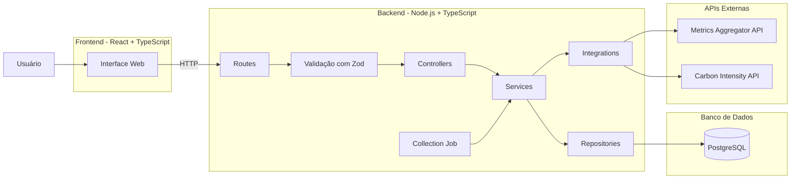

O backend funciona como intermediário entre o frontend, o banco de dados e as
APIs externas.

---

# 4. Estrutura do Backend

```text
backend/
├── .env.example
├── Dockerfile
├── package.json
├── src/
│   ├── app.ts
│   ├── index.ts
│   ├── server.ts
│   ├── db/
│   │   └── connection.ts
│   ├── integrations/
│   │   ├── carbon-api.ts
│   │   ├── carbon-api.schema.ts
│   │   ├── metrics-api.ts
│   │   ├── metrics-api.schema.ts
│   │   └── metrics-api.mapper.ts
│   ├── jobs/
│   │   └── collections.job.ts
│   ├── modules/
│   │   ├── analytics/
│   │   ├── collections/
│   │   ├── comparisons/
│   │   ├── monitoring/
│   │   ├── rankings/
│   │   ├── regions/
│   │   └── services/
│   ├── scripts/
│   │   └── sync-regions.ts
│   └── shared/
│       ├── errors/
│       ├── middleware/
│       └── types/
└── tests/unit/
```

O módulo `monitoring` expõe `GET /api/v1/monitoring/status`. O
`monitoring.service.ts` guarda em memória os horários, contadores e resultados
informados pelo job e pelo serviço de coleta. O controller entrega esses
dados em JSON. Os dados são reiniciados com o processo.

---

# 5. Organização do Backend

O backend é organizado em diferentes responsabilidades:

```text
HTTP
 ↓
Routes
 ↓
Validação
 ↓
Controllers
 ↓
Services
 ↓
Repositories / Integrations
 ↓
PostgreSQL / APIs externas
```

Cada camada possui uma responsabilidade específica.

---

# 6. Configuração e comandos

As variáveis são carregadas com `dotenv/config`. Use [.env.example](./.env.example)
como referência e execute os comandos Node.js dentro de `backend/`.

| Variável                                              | Uso atual                                                                             |
| ----------------------------------------------------- | ------------------------------------------------------------------------------------- |
| `PORT`                                                | Porta HTTP; padrão `3000` quando ausente.                                             |
| `CORS_ORIGIN`                                         | Origem permitida pelo middleware CORS; exemplo `http://localhost:5173`.               |
| `DATABASE_HOST`                                       | `database` no Compose; `localhost` ao executar Node.js no host.                       |
| `DATABASE_PORT`                                       | `5432` no Compose; `5433` no host.                                                    |
| `DATABASE_NAME`, `DATABASE_USER`, `DATABASE_PASSWORD` | No Compose de desenvolvimento: `greener`, `postgres`, `postgres`.                     |
| `METRICS_API_URL`, `CARBON_API_URL`                   | Bases das integrações externas, obrigatórias para criar o serviço de coleta.          |
| `COLLECTION_INTERVAL_SECONDS`                         | Espera após cada rodada; padrão de 30 segundos para valor não positivo ou não finito. |
| `JWT_SECRET`                                          | Chave usada para assinar e verificar os tokens das contas.                            |

| Comando                | Finalidade                                                            |
| ---------------------- | --------------------------------------------------------------------- |
| `npm ci`               | Instalar as dependências do lockfile.                                 |
| `npm run dev`          | Executar `src/server.ts` com reinício ao alterar arquivos TypeScript. |
| `npm run build`        | Compilar o TypeScript para `dist/`.                                   |
| `npm start`            | Executar `dist/server.js` após o build.                               |
| `npm test`             | Executar os testes com Vitest.                                        |
| `npm run test:watch`   | Manter os testes em execução durante o desenvolvimento.               |
| `npm run lint`         | Verificar o código com ESLint, sem avisos permitidos.                 |
| `npm run format:check` | Conferir a formatação com Prettier.                                   |

Perfil, dashboards e relatórios exigem sessão. Configuração do projeto
também exige o papel de administrador.

# 7. Validação com Zod

O Zod é utilizado para validar dados em tempo de execução.

O TypeScript realiza validação de tipos durante o desenvolvimento, porém não
garante que dados recebidos através da rede tenham realmente o formato esperado.

Por esse motivo, o Zod é utilizado para validar:

- `body`;
- `params`;
- `query parameters`;
- respostas recebidas das APIs externas.

---

## 7.1 Validação das requisições

Exemplo de fluxo:

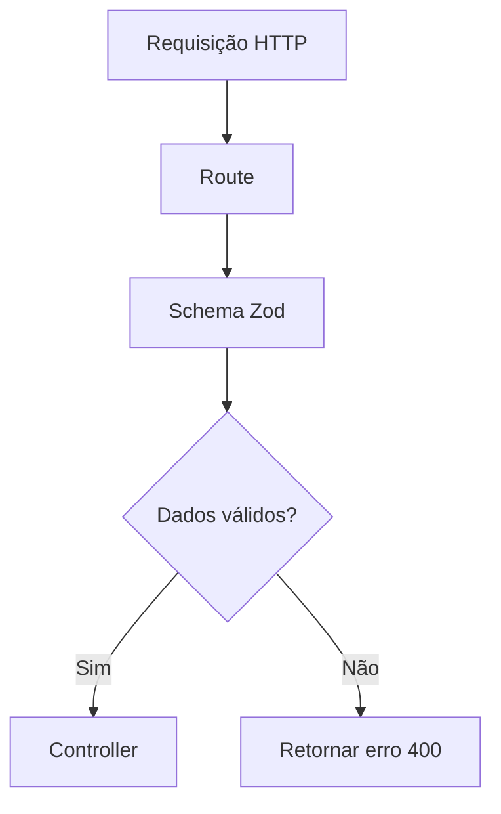

O contrato das requisições está descrito em
[docs/API.md](../docs/API.md).

Antes do controller receber os dados:

```text
Request
   ↓
Zod
   ↓
Dados válidos
   ↓
Controller
```

---

# 8. Validação das APIs Externas

Os dados retornados pelas APIs externas também devem ser considerados dados não
confiáveis até serem validados.

Por exemplo:

```text
Metrics API
    ↓
fetch
    ↓
JSON
    ↓
Zod
    ↓
objeto validado
    ↓
Service
```

Fluxo:

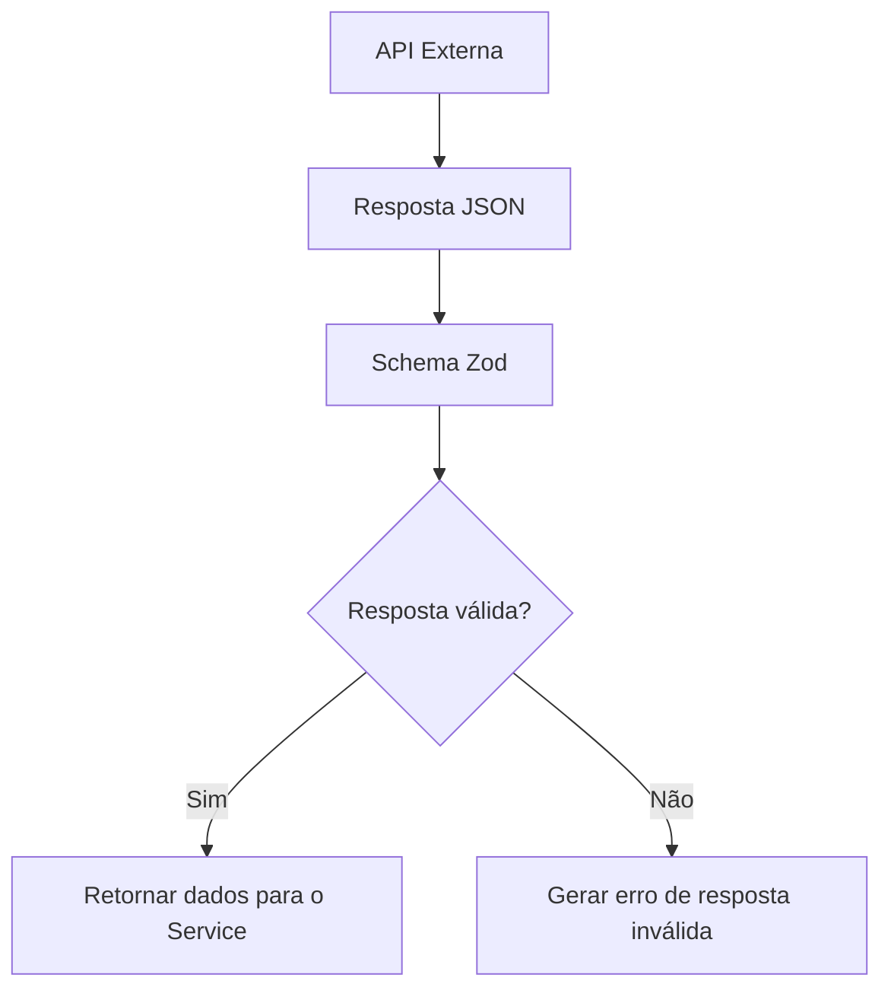

Isso evita que uma mudança inesperada na API externa gere dados incorretos
dentro da aplicação.

---

# 9. Controllers

Os controllers representam a camada HTTP da aplicação.

Responsabilidades:

- receber dados já validados;
- acessar parâmetros da requisição;
- chamar o service correspondente;
- definir status HTTP;
- retornar respostas JSON.

Exemplo:

```text
Route
  ↓
Controller
  ↓
Service
```

O controller não deve:

```text
❌ executar SQL
❌ acessar PostgreSQL diretamente
❌ fazer cálculos ambientais
❌ executar fetch para API externa
❌ implementar regras de negócio
```

---

# 10. Services

Os services concentram as regras de negócio e a coordenação das operações.

Eles podem utilizar:

- repositories;
- integrations;
- outros componentes necessários à regra de negócio.

Exemplo:

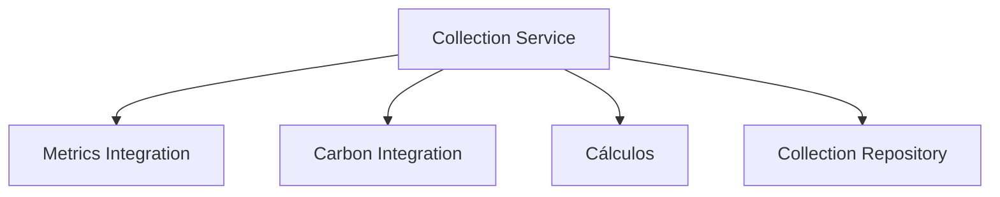

O Collection Service:

1. solicitar as métricas de um serviço;
2. obter a intensidade de carbono;
3. validar entradas e parâmetros do modelo;
4. calcular potência, energia e CO₂e conforme
   [docs/cálculo.md](../docs/cálculo.md);
5. criar uma coleta com seu contexto;
6. solicitar ao repository que persista os dados.

---

# 11. Repositories

Os repositories concentram todo o acesso ao PostgreSQL.

Exemplo:

```text
Service
   ↓
Repository
   ↓
pg
   ↓
PostgreSQL
```

Os repositories são responsáveis por:

- executar `SELECT`;
- executar `INSERT`;
- executar `UPDATE`;
- executar `DELETE`, quando necessário;
- realizar agregações;
- realizar consultas históricas;
- executar consultas parametrizadas.

Exemplo conceitual:

```text
CollectionRepository

save()

findById()

findByServiceId()

findByPeriod()

findLatestByServiceId()
```

Os repositories não devem:

```text
❌ chamar API externa
❌ calcular CO₂e
❌ controlar intervalo de monitoramento
❌ tratar requisição HTTP
❌ decidir regras de negócio
```

---

# 12. Integrations

A pasta `integrations` concentra a comunicação com sistemas externos.

```text
integrations/
├── metrics-api.ts
├── metrics-api.schema.ts
├── carbon-api.ts
└── carbon-api.schema.ts
```

A ideia é impedir que diferentes módulos da aplicação executem `fetch`
diretamente.

---

# 13. Metrics API Integration

O arquivo:

```text
metrics-api.ts
```

é responsável pela comunicação com a Greener Metrics Aggregator API.

Responsabilidades da integração:

```text
Consultar os serviços disponíveis e obter as métricas de um serviço.
```

Conceitualmente:

```text
getServices()

getMetrics(metricsPath)
```

Os endpoints e os formatos das respostas estão descritos em
[docs/API.md](../docs/API.md).

---

# 14. Carbon API Integration

O arquivo:

```text
carbon-api.ts
```

é responsável pela comunicação com a Greener Carbon Intensity API.

Fluxo:

```text
GET /regions na Carbon API
     ↓
Zod
     ↓
sincronização de regiões em CollectionsService
     ↓
fator regional armazenado no PostgreSQL
```

Os campos utilizados nessa integração estão descritos em
[docs/API.md](../docs/API.md).

---

# 15. Timeout das APIs Externas

As chamadas para APIs externas possuem timeout para evitar que uma chamada que
não responde bloqueie indefinidamente o processo de monitoramento.

O timeout definido para chamadas externas é:

```text
Timeout: 8 segundos
```

O timeout de 8 segundos é uma decisão técnica da equipe.

Fluxo:

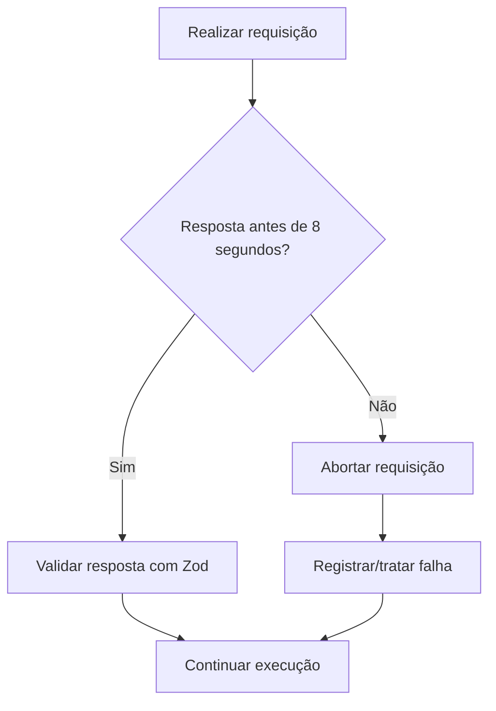

Uma falha em uma chamada externa não deve encerrar toda a aplicação.

---

# 16. Collection Job

O `collections.job.ts` é responsável por iniciar periodicamente o processo de
monitoramento.

O Job não deve implementar as regras de negócio da coleta.

Sua função é determinar **quando** o processo deve iniciar.

As regras sobre **como** executar a coleta ficam no service.

```text
Collection Job
      ↓
Collection Service
```

---

# 17. Configuração do Intervalo

O código em `jobs/collections.job.ts` lê `COLLECTION_INTERVAL_SECONDS`.
O valor deve ser um número positivo finito; caso contrário, o padrão é
30 segundos. O primeiro ciclo começa quando o servidor HTTP inicia.
Cada novo ciclo é agendado com `setTimeout` após o fim da rodada anterior.

```text
Backend iniciado → rodada → fim da rodada → espera configurada → nova rodada
```

Não há leitura de `configuracao_sistema` pelo job nem alteração do intervalo
por endpoint. A tabela existe com padrão de 300 segundos, sem controlar o
agendamento atual. Configuração pela aplicação está prevista para depois,
com sprint ainda a definir.

---

# 18. Diferença entre os Intervalos

Existem dois conceitos que não devem ser confundidos.

## Intervalo do Job

Define com que frequência o GreenER inicia uma nova rodada de monitoramento.

Exemplo:

```text
30 segundos
```

Representação:

```text
Rodada
  ↓
30 segundos
  ↓
Rodada
  ↓
30 segundos
  ↓
Rodada
```

---

## Collection Interval da API

O contrato da Metrics API inclui o intervalo associado às métricas retornadas.
Esse intervalo não deve ser confundido com a frequência do Job. O nome do campo
e seu formato estão descritos em [docs/API.md](../docs/API.md), e seu uso no
cálculo ambiental está em [docs/cálculo.md](../docs/cálculo.md).

---

# 19. Descoberta dos Serviços

Antes de realizar as coletas, o GreenER consulta a API de métricas para obter a
situação atual do ambiente. O endpoint correspondente está descrito em
[docs/API.md](../docs/API.md).

Isso permite detectar:

- novos serviços;
- serviços removidos;
- serviços que retornaram;
- alterações no ambiente monitorado.

Fluxo:

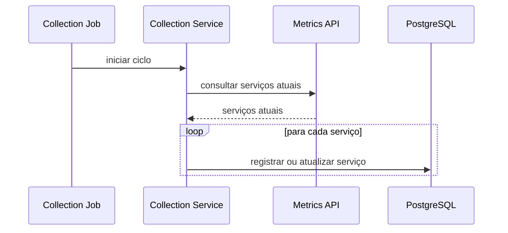

A API externa representa o estado atual dos serviços monitorados.

O banco mantém os dados necessários para histórico e utilização pela aplicação.

Os dados recebidos do Agregador são convertidos para a representação interna
`DiscoveredService`, definida em `src/shared/types/`. Ela concentra `id`,
`name`, `metricsPath` e `location` (código da região, país, região, cidade,
latitude e longitude). O mapeamento é feito por `toDiscoveredService`, em
`src/integrations/metrics-api.mapper.ts`, e a representação é utilizada pelo
módulo `collections` ao sincronizar os serviços descobertos. Os tipos de cada
módulo ficam em `src/modules/<módulo>/types/`.

---

# 20. Fluxo Geral de Monitoramento

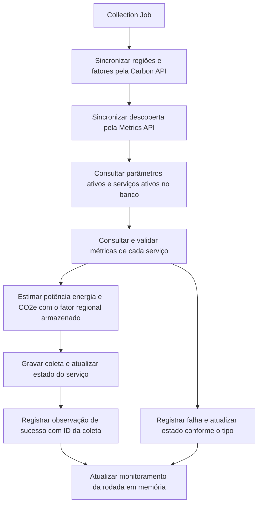

As consultas de métricas são iniciadas com `Promise.allSettled` sobre os
serviços selecionados. A falha isolada é registrada sem rejeitar as demais
coletas. Não há limitador de concorrência implementado.
Falhas externas na sincronização podem preservar dados já salvos; uma base
vazia sem regiões disponíveis pode impedir a descoberta e a coleta.

---

# 21. Collection Service

O Collection Service coordena o caso de uso de uma coleta.

Fluxo simplificado:

```text
collect(service)
    ↓
buscar métricas
    ↓
validar métricas
    ↓
usar intensidade regional previamente sincronizada e lida do banco
    ↓
combinar métricas com o conjunto ativo de parâmetros
    ↓
aplicar o cálculo ambiental descrito em docs/cálculo.md
    ↓
montar coleta
    ↓
persistir
```

Ele atua como o coordenador da operação.

---

# 22. Cálculos Ambientais

O Collection Service coordena os cálculos ambientais após validar as métricas e
obter a intensidade de carbono. As fórmulas e o fluxo detalhado estão em
[docs/cálculo.md](../docs/cálculo.md).

---

# 23. Persistência da Coleta

Depois dos cálculos, o Collection Service envia os dados para o repository.

```text
CollectionService
       ↓
CollectionRepository
       ↓
INSERT
       ↓
PostgreSQL
```

A tabela `coleta` guarda as métricas e estimativas da amostra, o conjunto de
parâmetros e o fator de carbono usado no cálculo. `servico.status` representa
o estado operacional atual. `status_coleta` guarda as observações de sucesso
e falha, incluindo ausências confirmadas na descoberta. O monitoramento da
rodada permanece em memória e é reiniciado com o processo.

Em caso de sucesso, o backend grava a amostra, atualiza o estado do serviço
para `available` e registra uma observação `success` com o ID da amostra.
Falhas de consulta e ausências na descoberta geram observações sem amostra.
O código HTTP é registrado quando há uma resposta HTTP de erro. As gravações
são independentes, então uma amostra salva pode sobreviver a uma falha na
gravação da observação. Consulte o [modelo do banco](../database/arquitetura.md)
e a [classificação das falhas](../docs/API.md#3-greener-metrics-aggregator-api).

---

# 24. Consulta do Frontend — implementada

O frontend não acessa diretamente as APIs externas.

Quando o dashboard precisa dos dados:

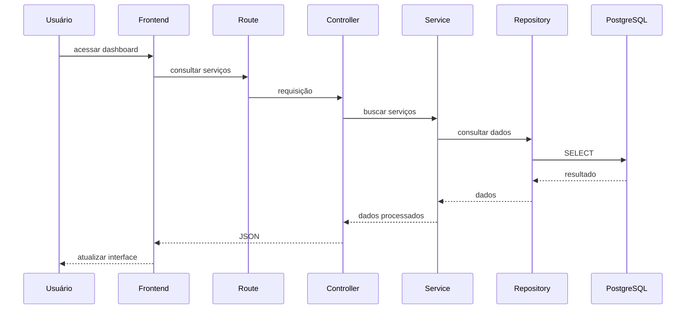

---

# 25. Separação entre Monitoramento e Consulta

O sistema possui dois fluxos principais.

## Fluxo de coleta

```text
Job
 ↓
Service
 ↓
APIs externas
 ↓
cálculos
 ↓
Repository
 ↓
PostgreSQL
```

## Fluxo de consulta

```text
Frontend
 ↓
Route
 ↓
Zod
 ↓
Controller
 ↓
Service
 ↓
Repository
 ↓
PostgreSQL
```

Isso significa que o frontend não precisa esperar uma API externa responder
para visualizar os dados já armazenados.

---

# 26. Atualização do Dashboard — implementada

`MonitoringProvider` acompanha `/api/v1/monitoring/status`; quando muda
`lastRoundFinishedAt`, `useApiQuery` solicita novamente os dados reais da página.
Lista, detalhe, histórico e totais regionais atualizam sem recarregar a página.
`MonitoringBar` distingue horário da coleta e atualização da tela. A consulta
segue a previsão do backend; o contador de segundos é apenas sua apresentação.
Ver [arquitetura do frontend](../frontend/arquitetura.md#7-atualização-e-estados-de-interface).

---

# 27. Tratamento de Falhas

O GreenER deve continuar funcionando mesmo quando alguma operação individual
falhar.

Possíveis falhas:

```text
API externa indisponível

timeout

serviço removido

serviço indisponível

serviço sem métricas

resposta inválida

falha de validação Zod

falha no banco de dados
```

---

# 28. Fluxo de Tratamento de Falhas

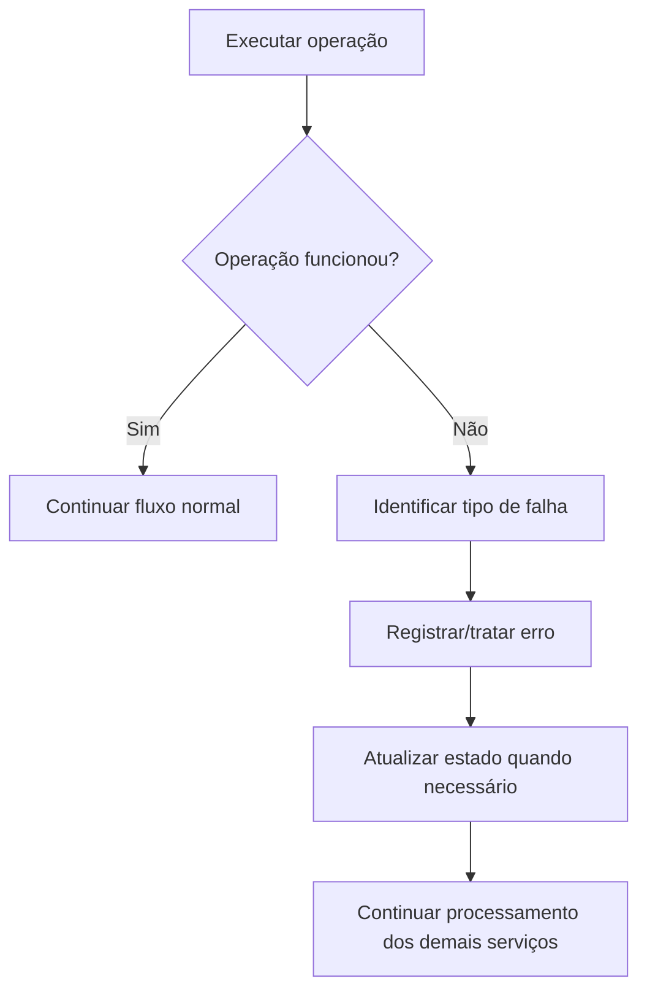

Uma falha em determinado serviço não deve encerrar o monitoramento completo.

---

# 29. Concorrência das Coletas

A arquitetura deve permitir que diferentes serviços sejam coletados sem que um
serviço lento bloqueie necessariamente todos os demais.

Exemplo de uma execução estritamente sequencial:

```text
Serviço A
    ↓
esperar

Serviço B
    ↓
esperar

Serviço C
```

Com timeout de 8 segundos, serviços indisponíveis podem aumentar a duração da
rodada quando são processados em sequência.

Exemplo conceitual:

```text
                  ┌── Serviço A
Collection Job ───┼── Serviço B
                  ├── Serviço C
                  └── Serviço D
```

As coletas usam `Promise.allSettled` para todos os serviços selecionados.
Não há fila ou limitador de concorrência; a quantidade de operações simultâneas
acompanha o número de serviços ativos. Um limite de concorrência é uma evolução possível, não uma garantia atual. Filas ou sistemas distribuídos não fazem parte da arquitetura do
GreenER.

---

# 30. Monitoramento Settings — planejado

O módulo `monitoring-settings` deverá administrar as configurações do
monitoramento. Ainda não está implementado; sua sprint de entrega não foi definida.

Possíveis configurações:

```text
collection_interval_seconds
```

Fluxo de alteração:

```text
Route
    ↓
Zod
    ↓
Controller
    ↓
Service
    ↓
Repository
    ↓
PostgreSQL
```

Os contratos propostos de configuração e simulação estão em
[docs/API.md](../docs/API.md). Quando implementados, deverão aplicar a proteção
prevista para cada operação. JWT será entregue na Sprint 3.

---

# 31. Autenticação — Sprint 3

A autenticação JWT das operações protegidas será implementada no backend
na Sprint 3. Dependências, JWT_SECRET e tabela usuario já existem, mas não
comprovam login, emissão de token ou autorização. Os diagramas abaixo são propostas.

Fluxo simplificado:

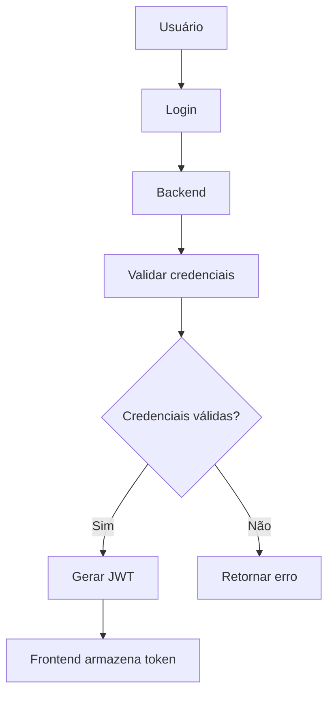

---

# 32. Acesso às Rotas Protegidas — fluxo planejado

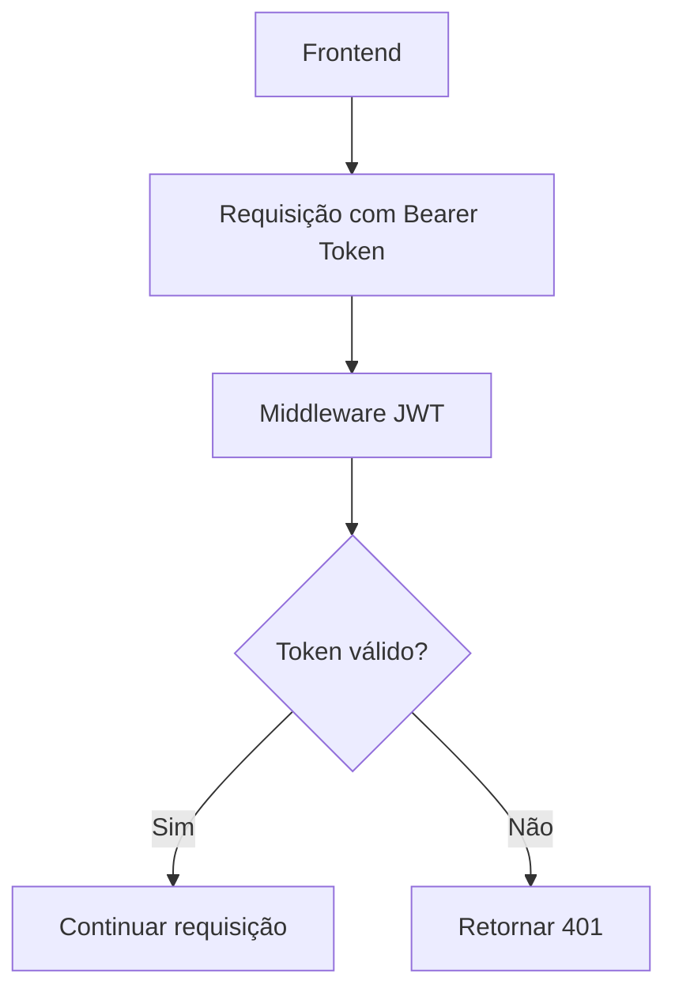

O controle de acesso não deve depender apenas do frontend.

---

# 33. Banco de Dados

O GreenER utiliza PostgreSQL.

A aplicação não utiliza ORM.

O acesso é realizado através do driver:

```text
pg
```

Os comandos SQL são mantidos explicitamente nos repositories.

Exemplo:

```text
Service
 ↓
Repository
 ↓
SQL parametrizado
 ↓
pg
 ↓
PostgreSQL
```

---

# 34. Consultas Parametrizadas

Dados recebidos da aplicação não devem ser concatenados diretamente nas
consultas SQL.

Conceitualmente:

```sql
SELECT *
FROM coleta
WHERE servico_id = $1;
```

Os valores são enviados separadamente através do driver PostgreSQL.

Isso reduz o risco de SQL Injection e mantém a separação entre comando e dados.

---

# 35. Docker

Toda a aplicação deve ser executável através de containers Docker.

A composição principal possui:

```text
Docker Compose
│
├── frontend
│
├── backend
│
└── PostgreSQL
```

Fluxo:

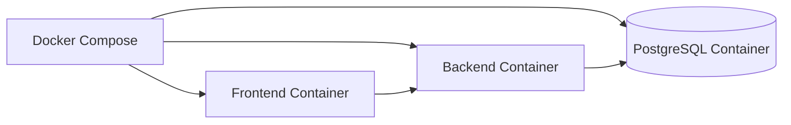

O banco deve utilizar volume persistente para manter os registros mesmo após a
reinicialização dos containers.

## Executar o backend localmente

Com Node.js 24 e Docker Compose, prepare os arquivos `.env` conforme o
[README](../README.md#como-executar). Execute na raiz do repositório para
subir apenas o PostgreSQL pelo Compose e rodar o Node.js no host.

```powershell
docker compose up -d --wait database
Set-Location backend
```

No `.env` do backend, use `DATABASE_HOST=localhost` e `DATABASE_PORT=5433`
para acessar a porta publicada pelo Compose. Ao executar o backend dentro do
Compose, use `DATABASE_HOST=database` e `DATABASE_PORT=5432`.
`METRICS_API_URL` e `CARBON_API_URL` são obrigatórias na inicialização.
`PORT` define a porta HTTP e `CORS_ORIGIN` configura a origem do frontend.

Ainda em `backend/`, instale as dependências e inicie o processo de desenvolvimento.

```powershell
npm ci
npm run dev
```

Em outro terminal, consulte o processo, o monitoramento em memória e o
histórico persistido da última tentativa por serviço.

```powershell
Invoke-RestMethod http://localhost:3000/health
Invoke-RestMethod http://localhost:3000/api/v1/monitoring/status
Invoke-RestMethod 'http://localhost:3000/api/v1/collections/status?page=1&limit=20'
```

`/health` confirma que o processo HTTP responde. Para a última situação
observada das integrações e do banco, consulte `/api/v1/monitoring/status`.
Os comandos `npm test` e `npm run build` também são executados em `backend/`.

---

# 36. Fluxo Completo do GreenER

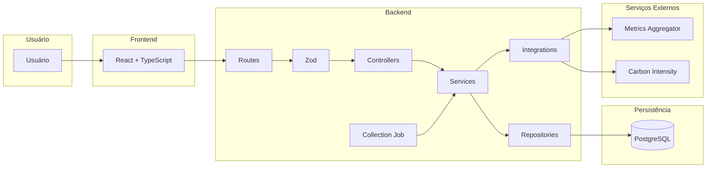

---

# 37. Resumo das Responsabilidades

| Componente                | Responsabilidade                                                                                               |
| ------------------------- | -------------------------------------------------------------------------------------------------------------- |
| Frontend                  | Apresentar informações e permitir interação com o usuário                                                      |
| Routes                    | Definir endpoints HTTP                                                                                         |
| Zod                       | Validar entradas e dados externos em runtime                                                                   |
| Controllers               | Receber requisições e produzir respostas HTTP                                                                  |
| Services                  | Implementar e coordenar regras de negócio                                                                      |
| Repositories              | Concentrar acesso ao PostgreSQL                                                                                |
| Integrations              | Concentrar comunicação com APIs externas                                                                       |
| Collection Job            | Iniciar periodicamente os ciclos de monitoramento                                                              |
| Auth (Sprint 3)           | Autenticar usuários e emitir tokens JWT; ainda não implementado                                                |
| Regions                   | Consulta regiões, fatores ambientais, contadores e totais do período; a sincronização continua em collections. |
| Analytics                 | Consulta histórico e totais das amostras por serviço.                                                          |
| Comparisons               | Compara serviços e simula emissões em outra região.                                                            |
| Collections e Services    | Consultam a última tentativa e o histórico de observações por serviço.                                         |
| PostgreSQL                | Persiste serviços, regiões, parâmetros, amostras e observações.                                                |
| Metrics API               | Fornecer serviços e métricas                                                                                   |
| Carbon API                | Fornecer intensidade de carbono                                                                                |
| JWT Middleware (Sprint 3) | Proteção planejada, ainda ausente                                                                              |

---

# 38. Decisões Arquiteturais

## 38.1 Backend modular

O backend é organizado em módulos de acordo com os recursos e
responsabilidades da aplicação.

Exemplos:

```text
collections

services

monitoring-settings
```

---

## 38.2 Separação entre Controller e Service

Controllers tratam HTTP.

Services tratam regras de negócio.

Essa separação evita que regras importantes fiquem diretamente ligadas ao
Express.

---

## 38.3 Repository para acesso ao banco

O acesso ao PostgreSQL fica concentrado nos repositories.

Isso permite manter as consultas SQL separadas das regras de negócio.

---

## 38.4 Integration para APIs externas

Chamadas HTTP para sistemas externos ficam concentradas na camada de
`integrations`.

Isso evita duplicação de código e facilita o tratamento de:

- timeout;
- respostas inválidas;
- indisponibilidade;
- mudanças no formato das APIs.

---

## 38.5 Zod para validação runtime

O Zod é utilizado para garantir que dados recebidos externamente possuam o
formato esperado antes de serem utilizados pela aplicação.

O Zod é utilizado tanto nas requisições recebidas pelo GreenER quanto nas
respostas recebidas das APIs auxiliares.

---

## 38.6 Job separado da regra de negócio

O Job é responsável somente pelo agendamento da execução.

A coleta propriamente dita pertence ao Collection Service.

```text
Job
 ↓
Service
```

Isso permite reutilizar o mesmo service independentemente de quem iniciou a
operação.

---

## 38.7 Timeout de 8 segundos

As chamadas para APIs externas utilizam timeout de:

```text
8 segundos
```

Uma chamada que excede esse limite é abortada e tratada como falha daquela
operação; a rodada continua processando os demais serviços.

---

## 38.8 Persistência histórica

As telas de detalhe e comparação consultam as amostras armazenadas no
PostgreSQL. O dashboard também consulta os resultados das tentativas
persistidos em `status_coleta`. Consulte as [rotas disponíveis](../docs/API.md#21-operações-implementadas).

---

# 39. Classificação das Decisões

É importante diferenciar requisitos obrigatórios de decisões internas da equipe.

## Requisitos do produto

- React com TypeScript;
- Node.js com TypeScript;
- PostgreSQL;
- SQL explícito;
- sem ORM;
- Docker;
- JWT no backend;
- coleta periódica;
- histórico das coletas;
- tolerância a falhas;
- organização do backend em módulos, controllers e services;
- API HTTP para comunicação com o frontend.

## Decisões arquiteturais adotadas

- utilização de Express;
- utilização de Zod;
- utilização de `pg`;
- pasta `integrations`;
- pasta `jobs`;
- timeout de 8 segundos;
- intervalo atual por variável de ambiente; configuração pela aplicação futura;
- organização interna dos arquivos dos módulos.

## Parâmetros de operação

`COLLECTION_INTERVAL_SECONDS` controla a espera entre rodadas. O job não lê
o campo de configuração já existente no banco. `monitoring-settings` é futuro.
O intervalo da amostra da API é usado no cálculo energético e não agenda o job.
A interface acompanha o estado do job e busca os dados após a conclusão das rodadas;
o intervalo da amostra continua independente desse agendamento.

Políticas de limite de concorrência e novas tentativas não estão implementadas
como mecanismos próprios nesta versão. A falha de uma rodada é tratada e o job
agenda a seguinte enquanto estiver ativo.

---

# 40. Arquitetura Resumida

```text
                              USUÁRIO
                                 │
                                 ▼
                    ┌──────────────────────┐
                    │       FRONTEND       │
                    │   React + TypeScript │
                    └──────────┬───────────┘
                               │ HTTP
                               ▼
                    ┌──────────────────────┐
                    │        ROUTES        │
                    └──────────┬───────────┘
                               │
                               ▼
                    ┌──────────────────────┐
                    │         ZOD          │
                    │      Validação       │
                    └──────────┬───────────┘
                               │
                               ▼
                    ┌──────────────────────┐
                    │     CONTROLLERS      │
                    └──────────┬───────────┘
                               │
                               ▼
                    ┌──────────────────────┐
                    │       SERVICES       │
                    │ Regras de negócio    │
                    └─────┬─────────┬──────┘
                          │         │
              ┌───────────┘         └────────────┐
              ▼                                  ▼
    ┌─────────────────────┐           ┌─────────────────────┐
    │    REPOSITORIES     │           │    INTEGRATIONS     │
    │    SQL explícito    │           │ APIs externas       │
    └─────────┬───────────┘           └──────────┬──────────┘
              │                                  │
              ▼                         ┌────────┴─────────┐
        ┌─────────────┐                 ▼                  ▼
        │ PostgreSQL  │           Metrics API        Carbon API
        └─────────────┘


                     COLLECTION JOB
                           │
                           │ inicia periodicamente
                           ▼
                       SERVICES
```

---

# 41. Fluxo Resumido de uma Coleta

```text
Collection Job
      ↓
ler intervalo do ambiente
      ↓
Collection Service
      ↓
sincronizar regiões e serviços, depois buscar os serviços ativos
      ↓
para cada serviço
      ↓
consultar e validar métricas
      ↓
obter e validar intensidade de carbono
      ↓
aplicar cálculo ambiental descrito em docs/cálculo.md
      ↓
Collection Repository
      ↓
PostgreSQL
```

---

# 42. Objetivo da Arquitetura

A arquitetura do GreenER mantém uma separação clara de responsabilidades,
permitindo que cada parte da aplicação tenha um objetivo específico.

O objetivo não é criar o maior número possível de camadas ou abstrações, mas
organizar o sistema de maneira que seja possível compreender:

- quem recebe a requisição;
- quem valida os dados;
- quem executa regras de negócio;
- quem acessa APIs externas;
- quem acessa o banco;
- quem executa as coletas periódicas;
- onde os cálculos ambientais são realizados;
- como os dados chegam até o usuário.

Dessa forma, o GreenER é construído por etapas sobre uma estrutura
compreensível, preservando os contratos entre frontend, backend, integrações e
persistência.
