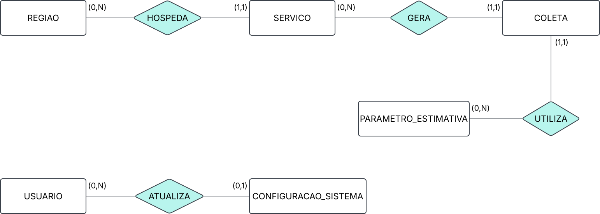
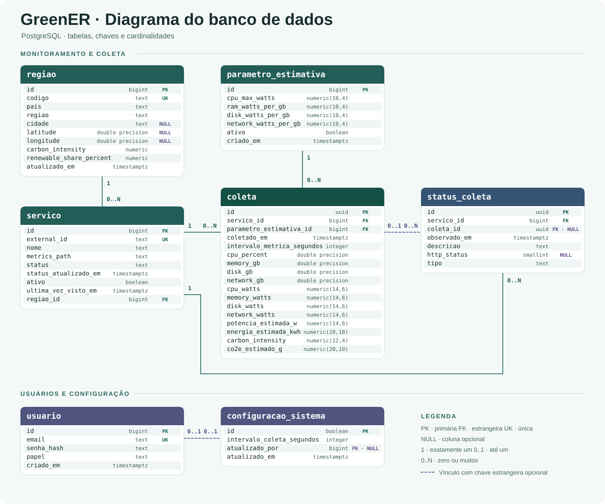

# 🏗️ Arquitetura e Modelagem

O [schema.sql](./schema.sql) define o esquema PostgreSQL usado pelo GreenER.
O [DER atual](#diagrama-entidade-relacionamento-der) inclui o histórico de
tentativas em `status_coleta`. `usuario` e `configuracao_sistema` preparam a
estrutura para autenticação e configuração de monitoramento.

## Histórico de tentativas (`status_coleta`)

| Coluna | Tipo | Uso |
|---|---|---|
| `id` | `UUID` | Chave primária gerada por `uuid_generate_v4()`. |
| `servico_id` | `BIGINT` | FK obrigatória para `servico.id`. |
| `coleta_id` | `UUID` | FK opcional para `coleta.id`, preenchida pelo backend nas observações de sucesso. |
| `observado_em` | `TIMESTAMPTZ` | Horário do registro da observação, com padrão `now()`. |
| `descricao` | `TEXT` | Mensagem obrigatória associada à observação. |
| `http_status` | `SMALLINT` | Código HTTP de erro quando disponível, com `CHECK` entre 100 e 599. O backend grava `NULL` em sucessos e falhas sem código. |
| `tipo` | `TEXT` | Classificação obrigatória definida pelo backend, como `success`, `service_missing` ou `timeout`. |

`idx_status_coleta_servico_tempo` indexa `(servico_id, observado_em DESC)`.
As consultas ordenam pelo horário e usam o UUID como desempate. A listagem
de status usa a observação mais recente de cada serviço e consulta a última
amostra salva separadamente. O histórico por serviço retorna até 100 registros.
Consulte o [contrato da API](../docs/API.md#status-das-coletas-por-serviço).

| Informação | Fonte | Significado |
|---|---|---|
| `servico.ativo` | Descoberta de serviços | Indica se o serviço está listado no agregador. |
| `servico.status` | Estado operacional atual | `available`, `metrics_missing` ou `unavailable`. |
| `coleta` | Amostras válidas | Métricas, estimativas e contexto usados nas consultas históricas. |
| `status_coleta` | Observações persistidas | Registra sucessos, falhas e ausências confirmadas na descoberta. |

As gravações da amostra, do estado atual e da observação são comandos separados.
Uma amostra pode existir mesmo quando o registro da observação falha.

Cada observação pertence a um serviço. O vínculo com a amostra é opcional,
e `coleta_id` pode aparecer em mais de uma observação segundo as restrições
do SQL. Na rotina de coleta, o backend associa a amostra ao registrar sucesso.

Esta seção reúne os artefatos de modelagem de dados desenvolvidos para o projeto **GreenER**.

Os diagramas servem como apoio para análise, implementação e evolução da solução ao longo das sprints, permitindo visualizar as principais entidades, atributos e relacionamentos do banco de dados da plataforma.

Além da visualização em imagem, os diagramas possuem seus respectivos arquivos editáveis no Lucidchart, possibilitando consulta detalhada e navegação pelos elementos modelados.

---

## 🛠️ Ferramenta Utilizada

<a href="https://www.lucidchart.com/" target="_blank">
    
</a>

Ferramenta utilizada para a criação e manutenção dos diagramas do projeto.

Por meio dela são desenvolvidos os diagramas utilizados na documentação da aplicação, permitindo representar visualmente os principais aspectos da solução.

---

## 📋 Diagramas originais

Os arquivos Lucidchart e os SVGs originais registram o modelo inicial. O DER
atual acompanha o SQL e inclui `status_coleta`.

| Diagrama | Descrição                                                                                                  |
| -------- | ---------------------------------------------------------------------------------------------------------- |
| MER      | Modelo conceitual do banco de dados, com as entidades, seus relacionamentos e cardinalidades               |
| DER      | Modelo lógico do banco de dados, com tabelas, atributos, tipos, chaves primárias e estrangeiras           |

---

# 🧩 Modelo Entidade-Relacionamento (MER)

## Visualização

<p align="center">
    
</p>

## Arquivo Original

🔗 Lucidchart: [Acessar diagrama](https://lucid.app/lucidchart/a9acb0c6-6bad-4719-8734-a0f1a9c5b4c1/view)

## Objetivo

Representar, em nível conceitual, as entidades do domínio da plataforma GreenER e a forma como elas se relacionam, sem considerar detalhes de implementação como atributos, tipos de dados e chaves estrangeiras. Os atributos de cada entidade são detalhados no DER.

## Notação

- **Retângulo:** entidade.
- **Losango:** relacionamento.
- **(mín, máx):** cardinalidade de cada entidade no relacionamento.

## Entidades

| Entidade               | Descrição                                                                                        |
| ---------------------- | ------------------------------------------------------------------------------------------------ |
| `USUARIO`              | Pessoa com acesso à plataforma, com papel de administrador ou visualizador                       |
| `CONFIGURACAO_SISTEMA` | Configuração global do sistema, como o intervalo de coleta (existe uma única configuração)       |
| `REGIAO`               | Localização geográfica onde os serviços rodam, com intensidade de carbono e percentual renovável |
| `SERVICO`              | Serviço monitorado pela plataforma, com status e caminho de métricas                             |
| `PARAMETRO_ESTIMATIVA` | Coeficientes de potência usados para estimar o consumo de energia                                |
| `COLETA`               | Medição de um serviço em um instante, com consumo de energia e emissão de CO₂e estimados         |

## Relacionamentos

| Relacionamento | Entidades                          | Cardinalidade                                                                                |
| -------------- | ---------------------------------- | -------------------------------------------------------------------------------------------- |
| `HOSPEDA`      | `REGIAO` e `SERVICO`               | Uma região hospeda zero ou muitos serviços; um serviço pertence a uma região                 |
| `GERA`         | `SERVICO` e `COLETA`               | Um serviço gera zero ou muitas coletas; uma coleta pertence a um serviço                     |
| `UTILIZA`      | `PARAMETRO_ESTIMATIVA` e `COLETA`  | Um parâmetro é usado em zero ou muitas coletas; uma coleta usa um parâmetro                  |
| `ATUALIZA`     | `USUARIO` e `CONFIGURACAO_SISTEMA` | Um usuário referencia zero ou uma configuração global; cada configuração tem no máximo um usuário |

---

# Diagrama Entidade-Relacionamento (DER)

## Visualização



[Abrir o DER atual em tamanho completo](./images/DiagramaDERAtual.svg)

## Modelo original

O diagrama inicial está disponível em [SVG](./images/DiagramaDER.svg) e no
[Lucidchart](https://lucid.app/lucidchart/a428841e-d545-4f2d-b834-a19170ff7bd1/view).

## Objetivo

Representar o modelo lógico do banco de dados PostgreSQL da plataforma GreenER, detalhando as tabelas, os tipos de dados, as chaves primárias (`PK`), as chaves estrangeiras (`FK`) e as restrições de unicidade (`UK`).

## Relacionamentos

| Tabela referenciada | Tabela com a FK | Chave estrangeira | Cardinalidade |
| --- | --- | --- | --- |
| `regiao` | `servico` | `regiao_id` | 1 para 0..N |
| `servico` | `coleta` | `servico_id` | 1 para 0..N |
| `parametro_estimativa` | `coleta` | `parametro_estimativa_id` | 1 para 0..N |
| `servico` | `status_coleta` | `servico_id` | 1 para 0..N |
| `coleta` | `status_coleta` | `coleta_id` | 0..1 para 0..N |
| `usuario` | `configuracao_sistema` | `atualizado_por` | 0..1 para 0..1 |

## Dicionário de dados

Os tipos e campos abaixo correspondem ao [schema.sql](./schema.sql). Todas as
datas usam `TIMESTAMPTZ`. Campos opcionais aceitam `NULL`.

| Tabela | Colunas |
| --- | --- |
| `usuario` | `id BIGINT` (identity, PK); `email TEXT` (único); `senha_hash TEXT`; `papel TEXT` (padrão `admin`); `criado_em TIMESTAMPTZ`. |
| `regiao` | `id BIGINT` (identity, PK); `codigo TEXT` (único); `pais TEXT`; `regiao TEXT`; `cidade TEXT` (opcional); `latitude` e `longitude DOUBLE PRECISION` (opcionais); `carbon_intensity NUMERIC`; `renewable_share_percent NUMERIC`; `atualizado_em TIMESTAMPTZ`. |
| `servico` | `id BIGINT` (identity, PK); `external_id TEXT` (único); `nome TEXT`; `metrics_path TEXT`; `status TEXT` (padrão `available`); `status_atualizado_em TIMESTAMPTZ`; `ativo BOOLEAN` (padrão `true`); `ultima_vez_visto_em TIMESTAMPTZ`; `regiao_id BIGINT` (FK). |
| `parametro_estimativa` | `id BIGINT` (identity, PK); `cpu_max_watts`, `ram_watts_per_gb`, `disk_watts_per_gb`, `network_watts_per_gb`: `NUMERIC(10,4)`; `ativo BOOLEAN` (padrão `false`); `criado_em TIMESTAMPTZ`. |
| `configuracao_sistema` | `id BOOLEAN` (PK, apenas `true`); `intervalo_coleta_segundos INTEGER` (padrão `300`); `atualizado_por BIGINT` (FK opcional); `atualizado_em TIMESTAMPTZ`. |
| `coleta` | `id UUID` (PK); `servico_id BIGINT` e `parametro_estimativa_id BIGINT` (FKs); `coletado_em TIMESTAMPTZ`; `intervalo_metrica_segundos INTEGER`; `cpu_percent`, `memory_gb`, `disk_gb`, `network_gb`: `DOUBLE PRECISION`; `cpu_watts`, `memory_watts`, `disk_watts`, `network_watts`, `potencia_estimada_w`: `NUMERIC(14,6)`; `energia_estimada_kwh` e `co2e_estimado_g`: `NUMERIC(20,10)`; `carbon_intensity NUMERIC(12,4)`. |
| `status_coleta` | Colunas detalhadas na seção Histórico de tentativas, no início deste documento. |

Todas as colunas de data têm padrão `now()`. Os UUIDs têm padrão
`uuid_generate_v4()`. CPU usa %, recursos usam GB, potência usa W, energia
usa kWh, emissões usam gCO₂e e intensidade usa gCO₂e/kWh. O intervalo da
métrica é medido em segundos.

## Índices

Além dos índices das PKs e restrições `UNIQUE`, o schema declara:

| Índice | Colunas / condição |
| --- | --- |
| `ux_parametro_estimativa_ativo` | `parametro_estimativa(ativo) WHERE ativo = true`, único. |
| `idx_servico_regiao` | `servico(regiao_id)`. |
| `idx_servico_ativo` | `servico(ativo)`. |
| `idx_coleta_servico_tempo` | `coleta(servico_id, coletado_em DESC)`. |
| `idx_coleta_tempo` | `coleta(coletado_em DESC)`. |
| `idx_status_coleta_servico_tempo` | `status_coleta(servico_id, observado_em DESC)`. |

## Regras de Negócio no Banco

Algumas regras são garantidas pelo próprio banco e não aparecem graficamente no diagrama:

- **Integridade referencial:** as FKs não declaram exclusão em cascata. Excluir um registro ainda referenciado gera conflito. `status_coleta.tipo` é texto livre no SQL; a classificação é feita pelo backend. O banco não garante que a coleta vinculada a uma observação pertença ao mesmo serviço da observação.
- **Configuração única:** `configuracao_sistema` aceita apenas uma linha (`id BOOLEAN` com `CHECK (id = true)`).
- **Parâmetro ativo único:** índice único parcial em `parametro_estimativa(ativo) WHERE ativo = true`, que permite apenas um conjunto de parâmetros ativo por vez.
- **Coleta única por instante:** `UNIQUE (servico_id, coletado_em)` impede duas coletas do mesmo serviço no mesmo instante.
- **Valores controlados:** `usuario.papel` aceita `admin` ou `visualizador`, e `servico.status` aceita `available`, `metrics_missing` ou `unavailable`.
- **Valores válidos:** `CHECK` impede valores negativos nas métricas e nos cálculos, limita percentuais entre 0 e 100 e limita o intervalo de configuração armazenado entre 10 e 3600 segundos. Esse CHECK não valida a variável de ambiente que agenda o job.
- **Fator de carbono da coleta.** `coleta.carbon_intensity` guarda o fator regional usado no cálculo. Atualizações posteriores de `regiao.carbon_intensity` preservam as estimativas armazenadas. A coleta não guarda uma FK para a região original. Por isso, os totais regionais agrupam as amostras pela região atual do serviço.

## Operação do banco e persistência

O [schema.sql](./schema.sql) cria sete tabelas,
chaves, restrições, índices e a extensão `uuid-ossp`, em uma transação.
O seed insere um conjunto ativo de parâmetros e uma linha de configuração.
Serviços, regiões e coletas são obtidos durante a execução; não são seed estático.

| Tabela | Uso pela aplicação atual |
|---|---|
| regiao | Sincronização da Carbon API e fator regional para as coletas. |
| servico | Descoberta, estado e consultas por external_id. |
| parametro_estimativa | Conjunto ativo para as estimativas. |
| coleta | Gravação e consulta de detalhe, histórico e totais. |
| status_coleta | Gravação das observações e consulta da última tentativa e do histórico por serviço. |
| usuario | Estrutura disponível; autenticação prevista para a Sprint 3. |
| configuracao_sistema | Linha inicial disponível; ainda não controla o job. |

O Compose usa PostgreSQL 17 e publica a porta `localhost:5433`. O backend
executado no Compose usa `database:5432`.
Banco, usuário e senha de desenvolvimento estão no Compose e nos exemplos.
O volume nomeado `postgres_data` preserva os registros ao recriar containers.
O entrypoint aplica o script somente ao inicializar um volume vazio.

### Aplicar o DDL em um banco vazio

O schema não é idempotente. Não reaplicá-lo sobre um banco já inicializado.
Para verificar a estrutura em outro PostgreSQL vazio, usando cliente psql e
uma conexão de avaliação preparada pelo responsável:

```powershell
psql --host localhost --port 5433 --username postgres --dbname NOME_DO_BANCO_VAZIO --set ON_ERROR_STOP=1 --file database/schema.sql
```

Substitua `NOME_DO_BANCO_VAZIO` pelo banco vazio escolhido. O comando parte da
raiz do repositório e requer cliente psql instalado no host. O fluxo usual com
Compose já aplica o script automaticamente na primeira inicialização.
Uma alteração posterior no arquivo não migra volumes existentes.

### Conferir um volume existente

```powershell
docker compose exec -T database psql -U postgres -d greener -c "SELECT to_regclass('public.status_coleta') AS tabela, to_regclass('public.idx_status_coleta_servico_tempo') AS indice;"
```

Se algum resultado vier vazio, faça backup do banco e aplique a
[migração de status de coleta](./migrations/001_status_coleta.sql) a partir da
raiz do repositório, com o container do banco ativo.

```powershell
Get-Content -Raw database/migrations/001_status_coleta.sql |
    docker compose exec -T database psql -X -v ON_ERROR_STOP=1 -U postgres -d greener
```

A migração cria a tabela e o índice em uma transação e pode ser reaplicada.
Repita a consulta acima para conferir a estrutura e consulte as coletas
existentes. Amostras anteriores à migração podem não ter observações de
tentativa correspondentes.

### Consultar a estrutura e as coletas existentes

Na raiz do projeto, com os containers ativos:

```powershell
docker compose exec -T database psql -U postgres -d greener -c "SELECT tablename FROM pg_tables WHERE schemaname = 'public' ORDER BY tablename;"
docker compose exec -T database psql -U postgres -d greener -c "SELECT count(*) AS coletas, max(coletado_em) AS ultima_coleta FROM coleta;"
docker compose exec -T database psql -U postgres -d greener -c "SELECT s.external_id, sc.observado_em, sc.tipo, sc.http_status, sc.coleta_id FROM status_coleta sc JOIN servico s ON s.id = sc.servico_id ORDER BY sc.observado_em DESC, sc.id DESC LIMIT 10;"
```

Para validar retenção, registrar contagens e uma coleta identificável antes e
depois de uma reinicialização controlada. Não confundir volume declarado no
Compose com uma verificação de retenção já executada.

### SQL utilizado pela aplicação

- `RankingsRepository` consulta a última coleta global e soma energia, CO₂e e quantidade de amostras por serviço, incluindo serviços sem amostras. [Código](../backend/src/modules/rankings/rankings.repository.ts)

- `CollectionsRepository` sincroniza serviços e regiões, grava amostras e observações e consulta a última tentativa de cada serviço. [Código](../backend/src/modules/collections/collections.repository.ts)
- `ServiceRepository` consulta listagem, detalhe, última amostra e histórico de tentativas por serviço. [Código](../backend/src/modules/services/services.repository.ts)
- `AnalyticsRepository` filtra por período e agrupa amostras em faixas de tempo para pontos e totais. [Código](../backend/src/modules/analytics/analytics.repository.ts)
- `RegionsRepository` consulta as regiões, os contadores de serviços e os totais por período. [Código](../backend/src/modules/regions/regions.repository.ts)
- `ComparisonsRepository` consulta o período comum, os totais, os pontos por faixa e o fator da região simulada. [Código](../backend/src/modules/comparisons/comparisons.repository.ts)

As consultas usam placeholders do pg, com valores separados do texto SQL.
Os fatores ambientais iniciais e suas limitações estão em [cálculo.md](../docs/cálculo.md).
Os quatro fatores iniciais correspondem ao exemplo do modelo simplificado do
desafio, citado na documentação de cálculo. O parâmetro de rede segue essa
simplificação; o schema não comprova calibração física do modelo.
